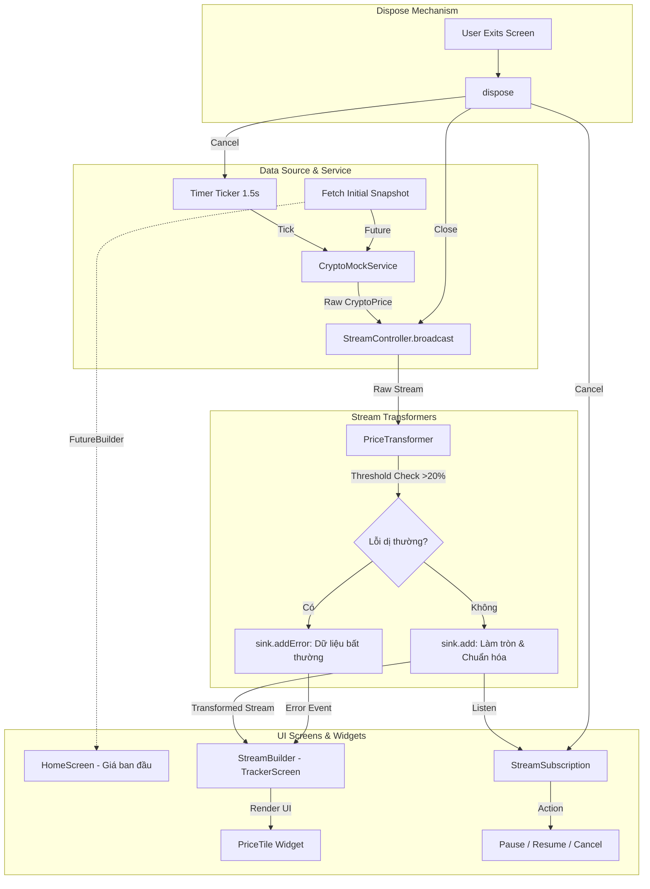

# Crypto Stream Tracker 📈

> **Báo cáo Chuyên đề: Dart & Flutter**  
> **Trường Đại học Bách Khoa – Đại học Đà Nẵng | Khoa Điện tử - Viễn thông**  
> **Giảng viên hướng dẫn:** TS. Nguyễn Duy Nhật Viễn  
> **Chủ đề 02:** Lập trình Bất đồng bộ với Future & Stream: Xây dựng Module Reactive thời gian thực

---

## 👥 1. Danh sách Thành viên & Bảng phân công (WBS)

| STT | Họ và tên | GitHub Username | Email | Vai trò chính trong dự án (WBS) |
|:---:|:---|:---|:---|:---|
| 1 | **Phan Vĩnh Sơn** (Trưởng nhóm) | [@phanvinhson205](https://github.com/phanvinhson205) | `pvson408@gmail.com` | **Business Logic & Reactive Engine:** Kiến trúc Stream, `CryptoMockService`, `PriceTransformer`, Unit Tests (`test/`), Tích hợp Git/CI |
| 2 | **Thành viên 2** | *Đang cập nhật* | *Đang cập nhật* | **UI Design & State Presentation:** Thiết kế `HomeScreen`, `TrackerScreen`, `PriceTile`, Quản lý vòng đời UI, Báo cáo & Slide thuyết trình |

---

## 🎯 2. Mục tiêu Kỹ thuật & Nội dung Cốt lõi

Đề tài tập trung nghiên cứu và hiện thực hóa các khái niệm bất đồng bộ chuyên sâu trong Dart & Flutter:

- **Event Loop & Microtask Queue**: Hiểu rõ chu trình xử lý sự kiện trong Single-thread của Dart.
- **Future & async/await**: Khởi tạo và tải dữ liệu giá mở phiên (Snapshot ban đầu) bất đồng bộ.
- **Stream & StreamController.broadcast**: Phát sinh luồng giá biến động thời gian thực tới nhiều màn hình/thành phần đồng thời.
- **StreamTransformer**:
  - Lọc dữ liệu dị thường (biến động vượt ngưỡng > 20% được chuyển đổi thành Error Event qua `EventSink.addError`).
  - Định dạng chuẩn hóa làm tròn 2 chữ số thập phân.
- **StreamSubscription & Quản lý vòng đời (Lifecycle)**:
  - Cho phép người dùng Tạm dừng (Pause), Tiếp tục (Resume) luồng dữ liệu.
  - Xử lý **Dispose an toàn** (đóng `StreamController`, hủy `StreamSubscription`, cancel `Timer`) khi thoát màn hình để triệt tiêu hoàn toàn rò rỉ bộ nhớ (Memory Leak).
- **StreamBuilder**: Kiểm tra toàn diện trạng thái Snapshot (`ConnectionState.waiting`, `ConnectionState.active`, `hasError`, `hasData`).

---

## 🏛️ 3. Sơ đồ Kiến trúc & Luồng dữ liệu (Data Flow)



---

## 📂 4. Cấu trúc Thư mục Dự án

Cấu trúc mã nguồn tuân thủ nghiêm ngặt nguyên tắc phân tách **Business Logic** và **UI Presentation**:

```text
lib/
├── main.dart                         # Entry point ứng dụng, cấu hình Theme
├── models/
│   └── crypto_price.dart             # Lớp dữ liệu bất biến (symbol, price, changePercent, timestamp)
├── services/
│   └── crypto_mock_service.dart      # Future (giá khởi tạo) + Stream (StreamController.broadcast) + dispose()
├── transformers/
│   └── price_transformer.dart        # StreamTransformer: lọc dị thường (>20% -> addError), làm tròn 2 số
├── views/
│   ├── home_screen.dart              # FutureBuilder: hiển thị snapshot khởi tạo, điều hướng sang Tracker
│   └── tracker_screen.dart           # StreamBuilder + StreamSubscription (pause/resume, đếm lỗi), dispose an toàn
└── widgets/
    └── price_tile.dart               # Widget hiển thị chi tiết biến động giá (màu sắc tăng/giảm)

test/
├── models/
│   └── crypto_price_test.dart        # Unit test cho model, immutability & copyWith
├── services/
│   └── crypto_mock_service_test.dart # Test Future, Stream phát dữ liệu, broadcast và đóng luồng
├── transformers/
│   └── price_transformer_test.dart   # Test biến đổi luồng, chặn biến động >20%, làm tròn giá
└── widget_test.dart                  # Widget test giao diện HomeScreen
```

---

## 🚀 5. Hướng dẫn Cài đặt & Chạy ứng dụng

### Yêu cầu tiên quyết
- **Flutter SDK**: `>= 3.0.0`
- **Dart SDK**: `>= 3.0.0`
- Thiết bị thật kết nối qua USB (bật USB Debugging) hoặc Máy ảo Android/iOS Emulator.

### Các bước khởi chạy

1. **Clone mã nguồn về máy**:
   ```bash
   git clone https://github.com/phanvinhson205/LTDNT.git
   cd LTDNT
   ```

2. **Cài đặt các gói phụ thuộc (Dependencies)**:
   ```bash
   flutter pub get
   ```

3. **Chạy toàn bộ Unit & Widget Tests**:
   ```bash
   flutter test
   ```

4. **Khởi chạy ứng dụng**:
   ```bash
   flutter run
   ```

---

## 🛡️ 6. Kiểm thử Tự động (Automated Testing)

Bộ kiểm thử được viết đầy đủ nhằm đảm bảo độ tin cậy và không bị lỗi hồi quy:
- **`crypto_mock_service_test.dart`**: Kiểm thử luồng phát dữ liệu định kỳ, kiểm tra tính chất Broadcast Stream và cơ chế hủy luồng.
- **`price_transformer_test.dart`**: Kiểm thử toán tử lọc nhiễu, bắt ngoại lệ dị thường và chuẩn hóa giá.
- **`widget_test.dart`**: Kiểm thử khả năng render trạng thái Loading/Data của Widget.

Chạy lệnh kiểm thử với độ bao phủ:
```bash
flutter test --coverage
```

---

## 📜 7. Quy chuẩn Commit & Đóng góp
Dự án áp dụng quy chuẩn **Conventional Commits**:
- `feat:` Thêm tính năng mới (Stream, Widget, Service).
- `fix:` Khắc phục lỗi (Memory leak, Unhandled stream error).
- `docs:` Bổ sung tài liệu, cập nhật README và WBS.
- `test:` Bổ sung hoặc cập nhật các ca kiểm thử.
- `refactor:` Tái cấu trúc mã nguồn mà không thay đổi logic nghiệp vụ.
